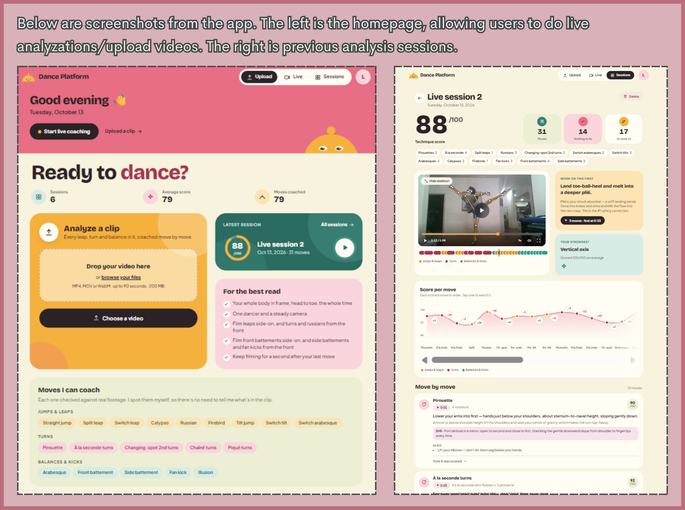

# Dance Technique Analysis Platform

## About this project
This project analyzes dance videos and provides targeted feedback to dancers on how to improve their technique. As a dancer and teacher, I love to share my passion for dance. But at my dance studio, only certain kids can take private classes because they're so expensive. I wanted to create a tool that allowed any kid to receive the same one-on-one feedback that private classes provide, inspiring me to build it.

## How it works
The app uses MediaPipe to track the dancer's body, letting the computer measure the angles their joints form throughout the video. It detects technique moves (jumps, leaps, and turns), scores each one against technique-based thresholds, and returns matching coaching corrections including what to fix, why it matters, and a drill to practice it. These critiques, alongside a compliment highlighting the dancer's strongest area, are shown around the MediaPipe-annotated video.

## What it does and does not critique
The app critiques **technique-based movements** — turns, leaps, jumps, flips, arabesques, battements.
These have a correct answer: a pirouette has a defined retiré, a vertical axis and a spot; a jeté has
a defined split, leg extension and landing. The geometry *is* the technique, so measuring it is real
coaching that a dancer can act on.

**Contemporary and interpretive movement is intentionally left alone.** There is no correct shape to
measure it against — choosing the shape is the artistic content. Grading it by joint angles would be
like asking a computer to grade an original painting, and a confident score on movement that has no
correct form is worse for a dancer than no score at all. So the app stays where it can be right.

## Screenshots

  

## Tech stack
- **Frontend:** Next.js, React, Tailwind CSS
- **Backend:** Python, FastAPI
- **Pose estimation & analysis:** MediaPipe, OpenCV, NumPy
- **Database, auth & storage:** Supabase (Postgres)
- **Video encoding:** ffmpeg

## Status
I have big goals for this project! I'm currently building real-time live webcam coaching — pose tracking, rep detection, and spoken corrections while you dance in front of your camera. After that, I'll wrap it as a mobile app for the App Store and get it hosted online.

## Setup
The app currently runs locally (a hosted version is coming by mid-August). It uses a Next.js frontend, a FastAPI backend, and Supabase for auth and storage — running it yourself requires your own free Supabase project.

**Prerequisites:** Node.js, Python 3.10+, ffmpeg, and a Supabase project.

1. **Backend:** `cd backend` → `pip install -r requirements.txt` → add your Supabase keys to `backend/.env` (see `backend/.env.example`) → `uvicorn main:app --reload`
2. **Frontend:** `cd frontend` → `npm install` → add your keys to `frontend/.env.local` (see `frontend/.env.example`) → `npm run dev`
3. Open http://localhost:3000

Full Supabase setup steps (tables, storage buckets, Google OAuth) are in [ROADMAP.md](./ROADMAP.md).

### Live coaching assets (/live)

The live page runs MediaPipe pose tracking entirely in the browser. Its assets are served from `frontend/public/` rather than a CDN so the wasm build always matches the installed npm package version and dev works offline: `npm run dev`/`build` automatically copies the wasm runtime out of `node_modules/@mediapipe/tasks-vision` and downloads the `pose_landmarker_lite` model (~5.5 MB, one time) via `frontend/scripts/copy-mediapipe-wasm.mjs`. Both locations are gitignored.

Note: the camera requires a secure context — `localhost` works for development, but opening the app from a phone over LAN needs https (planned for the hosted deployment).